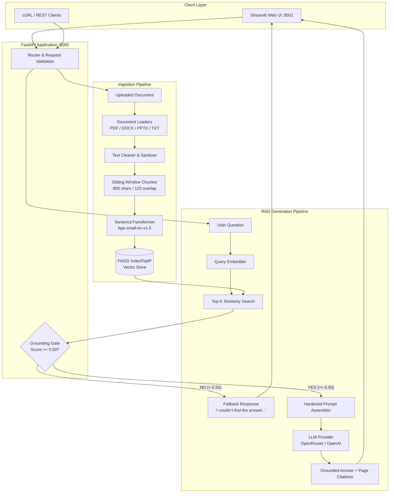

# DocuMind
> **Documentation-Grounded AI Assistant & Semantic RAG Engine**

[](https://www.python.org/)
[](https://fastapi.tiangolo.com/)
[](https://github.com/facebookresearch/faiss)
[](https://streamlit.io/)
[](https://github.com/Amitgupta0001/DocuMind)
[](https://opensource.org/licenses/MIT)

---

## 📌 Overview

**DocuMind** is an enterprise-grade, retrieval-augmented generation (RAG) system engineered to answer complex questions **strictly** from verified organizational documentation. Unlike generic chatbots that speculate or hallucinate when context is missing, DocuMind enforces a **two-tiered grounding architecture**:

1. **Semantic Similarity Gating**: Queries scoring below empirical cosine similarity thresholds ($0.50$) are rejected before touching the LLM, eliminating out-of-domain hallucinations and slashing inference costs.
2. **Hardened Context Grounding**: Retrieved document excerpts are treated as untrusted data within an injection-resistant prompt envelope, instructing the LLM to provide exact citations or output an explicit fallback answer.

Built with **FastAPI**, **FAISS**, **BAAI/bge-small-en-v1.5 embeddings**, and an interactive **Streamlit** dashboard, DocuMind supports multi-format document ingestion across **PDF**, **DOCX**, **PPTX**, and **TXT**.

---

## ✨ Key Features

- **Multi-Format Ingestion**: Automated parsing for PDF (via PyMuPDF), Word (`.docx`), PowerPoint (`.pptx`), and plain text (`.txt`).
- **Dense Vector Search**: Powered by Facebook AI Similarity Search (FAISS) using normalized `IndexFlatIP` (inner product cosine similarity).
- **Zero-Speculation Grounding Gate**: Automated fallback response triggered whenever retrieved context falls below strict similarity thresholds.
- **Prompt Injection Defense**: Untrusted document content is quarantined in isolated excerpt delimiters, preventing user document text from overriding assistant instructions.
- **Traceable Citations**: Every response returns exact source document names, locations, slide/page numbers, and similarity confidence scores.
- **Dual LLM Provider Support**: Native integration with OpenRouter (free and low-cost tiers) and direct OpenAI APIs with graceful timeout handling.
- **Enterprise Security**: Strict upload size limits ($25\text{ MB}$), file path sanitization against directory traversal, and full `.env` secret exclusion.
- **Empirical Evaluation Suite**: Automated benchmarking script measuring retrieval accuracy, fallback precision, and sub-$30\text{ms}$ query latencies.

---

## 🏗️ Architecture



---

## 🔄 RAG Pipeline Details

```text
Document Upload (.pdf / .docx / .pptx / .txt)
      ↓
Document Validation & Sanitization (Size limit: 25MB, safe filename)
      ↓
Text & Table Extraction (PyMuPDF, python-docx, python-pptx)
      ↓
Text Cleaning (Whitespace normalization, control character stripping)
      ↓
Deterministic Chunking (Sliding window: 800 chars, 120 overlap)
      ↓
Embedding Generation (BAAI/bge-small-en-v1.5, normalized L2 vectors)
      ↓
FAISS Vector Store (Persistent IndexFlatIP inner product index)
      ↓
User Query Input
      ↓
Query Embedding (BGE query prefix + normalization)
      ↓
FAISS Top-K Search (Cosine similarity score computation)
      ↓
Similarity Gate Check (Threshold >= 0.50)
      ├── Below Threshold → Immediate Fallback ("I couldn't find the answer...")
      └── Above Threshold → Chunk Deduplication & Context Formatting
            ↓
Prompt Construction (System instructions + Document excerpt delimiters)
            ↓
LLM Completion (temperature=0.0, deterministic response)
            ↓
Grounded Answer with Source, Page, and Similarity Confidence
```

---

## 🛠️ Tech Stack

| Component | Technology | Purpose |
|---|---|---|
| **API Framework** | FastAPI (Python 3.11+) | High-performance asynchronous REST API |
| **Frontend UI** | Streamlit | Responsive dashboard for document upload and chat |
| **Vector Database** | FAISS CPU (`faiss-cpu`) | Dense vector similarity indexing and nearest neighbor search |
| **Embeddings** | `sentence-transformers` (`BAAI/bge-small-en-v1.5`) | Local, high-precision semantic text embeddings (384 dims) |
| **Document Parsers** | PyMuPDF, `python-docx`, `python-pptx` | Extraction of text, slides, tables, and page metadata |
| **LLM Orchestration** | OpenAI Python SDK | Standardized interface for OpenRouter and OpenAI models |
| **Validation** | Pydantic v2 | Robust schema definitions and request validation |
| **Testing** | Pytest, HTTPX | Unit, integration, and mocking test suite |
| **Containerization** | Docker, Docker Compose | Reproducible multi-service deployment |

---

## 📂 Project Structure

```text
DocuMind/
├── .github/
│   └── workflows/
│       └── tests.yml            # Automated CI workflow
├── backend/
│   ├── chatbot/
│   │   ├── generator.py         # LLM answer generator & provider handling
│   │   └── prompt.py            # Prompt injection defense & context templates
│   ├── embeddings/
│   │   └── embedder.py          # BGE embedding model & query prefixing
│   ├── ingestion/
│   │   ├── chunker.py           # Text cleaner and deterministic chunker
│   │   └── document_loader.py   # PDF, Word, PowerPoint, Text parsers
│   ├── retrieval/
│   │   ├── retriever.py         # Top-K retrieval & similarity thresholding
│   │   └── vector_store.py      # Thread-safe persistent FAISS vector store
│   ├── config.py                # Environment configuration & validation
│   └── main.py                  # FastAPI server routes & middleware
├── documents/                   # Uploaded document storage
├── evaluation/
│   ├── questions.json           # RAG benchmark dataset
│   ├── evaluate.py              # Empirical evaluation runner
│   └── README.md                # Evaluation methodology documentation
├── frontend/
│   └── app.py                   # Streamlit interactive application
├── tests/
│   ├── conftest.py              # Pytest fixtures and mock models
│   ├── test_chat.py             # Chat endpoint tests
│   ├── test_chunker.py          # Text cleaning and chunking tests
│   ├── test_generator.py        # Prompt construction & generator tests
│   ├── test_health.py           # Health and root endpoint tests
│   ├── test_retrieval.py        # Vector search & threshold tests
│   └── test_upload.py           # File validation & upload tests
├── vectorstore/                 # FAISS index and metadata persistence
├── .dockerignore
├── .env.example                 # Environment configuration template
├── .gitignore
├── docker-compose.yml           # Multi-container orchestration
├── Dockerfile                   # Production container definition
├── requirements.txt             # Python dependencies
└── README.md                    # Platform documentation
```

---

## ⚡ Quick Start & Installation

### 1. Prerequisites
- **Python**: 3.11, 3.12, or 3.13
- **Git**

### 2. Clone Repository
```bash
git clone https://github.com/Amitgupta0001/DocuMind.git
cd DocuMind
```

### 3. Create Virtual Environment
```bash
python -m venv .venv

# On Windows PowerShell:
.\.venv\Scripts\Activate.ps1

# On Linux / macOS:
source .venv/bin/activate
```

### 4. Install Dependencies
```bash
pip install -r requirements.txt
```

---

## ⚙️ Environment Variables

Copy `.env.example` to `.env`:

```bash
cp .env.example .env
```

Configure your environment settings:

```env
# --- LLM Providers ---
LLM_PROVIDER=openrouter

# OpenRouter Configuration
OPENROUTER_API_KEY=your_openrouter_api_key_here
OPENROUTER_MODEL=liquid/lfm-2.5-2.6b:free
OPENROUTER_BASE_URL=https://openrouter.ai/api/v1

# OpenAI Configuration (Optional Alternative)
OPENAI_API_KEY=
OPENAI_MODEL=gpt-4o-mini

# --- Embedding & Retrieval Configuration ---
EMBEDDING_MODEL_NAME=BAAI/bge-small-en-v1.5
CHUNK_SIZE=800
CHUNK_OVERLAP=120
TOP_K=5
MAX_CONTEXT_CHUNKS=5
SIMILARITY_THRESHOLD=0.50
MIN_SIMILARITY_GAP=0.0

# --- Hallucination Fallback ---
FALLBACK_ANSWER=I couldn't find the answer in the provided documentation.

# --- Limits ---
MAX_FILE_SIZE_MB=25
REQUEST_TIMEOUT_SECONDS=60
```

---

## 🚀 Running the Services

### Start the FastAPI Backend
```bash
python -m uvicorn backend.main:app --host 127.0.0.1 --port 8000 --reload
```
- API Base: `http://127.0.0.1:8000`
- Interactive Swagger Docs: `http://127.0.0.1:8000/docs`

### Start the Streamlit Frontend
```bash
python -m streamlit run frontend/app.py
```
- Web Application: `http://localhost:8501`

---

## 🐳 Docker Deployment

Run the complete stack with a single command:

```bash
docker-compose up --build
```

- Streamlit Web UI: [http://localhost:8501](http://localhost:8501)
- FastAPI Swagger: [http://localhost:8000/docs](http://localhost:8000/docs)

---

## 📡 API Endpoints

| Method | Endpoint | Description | Request Payload / Params | Response |
|---|---|---|---|---|
| `GET` | `/` | Service information & endpoints | None | `{"app": "DocuMind", ...}` |
| `GET` | `/health` | System health & vector count | None | `{"status": "ok", "vector_count": 42, ...}` |
| `POST` | `/upload` | Ingest and index documentation | `multipart/form-data` (`file`) | `{"success": true, "chunks": 12, ...}` |
| `POST` | `/retrieve` | Semantic search & similarity check | `{"question": "..."}` | `{"relevant": true, "results": [...]}` |
| `POST` | `/chat` | Grounded answer with citations | `{"question": "..."}` | `{"answer": "...", "sources": [...]}` |
| `POST` | `/clear` | Reset vector store database | None | `{"success": true, "total_vectors": 0}` |

---

## 🧪 Testing

The test suite runs with fast mocked models (no live API keys required):

```bash
python -m pytest -v
```

### Test Coverage Highlights:
- **API Tests**: Valid and invalid payloads, missing fields, 400 Bad Request handling.
- **Upload Validation**: File size caps ($25\text{MB}$), unsupported format rejection, path traversal prevention.
- **Retrieval Engine**: Threshold gating, top-K selection, and chunk deduplication.
- **Generator**: Fallback validation, prompt injection resistance, and rate limit error recovery.

---

## 📊 Evaluation & Empirical Benchmarks

DocuMind features an automated empirical evaluation suite (`evaluation/evaluate.py`) that tests retrieval accuracy, threshold sensitivity, and fallback reliability against standardized test queries:

```bash
python evaluation/evaluate.py
```

### Empirical Results (BAAI/bge-small-en-v1.5 @ 0.50 Threshold):

```text
======================================================================
               📊 EMPIRICAL BENCHMARK SUMMARY
======================================================================
  • Total Evaluated Queries:       6
  • Retrieval Classification Acc:  100.0% (6/6)
  • Grounding Fallback Accuracy:   100.0% (6/6)
  • Average Retrieval Latency:     27.99 ms
======================================================================
```

---

## 🛡️ Security & Guardrails

- **Directory Traversal Protection**: Uploaded filenames are sanitized to prevent writing outside the designated storage folder.
- **Payload Size Capping**: File uploads are streamed with chunk-level byte counting, terminating any payload exceeding $25\text{MB}$ with `413 Request Entity Too Large`.
- **Secret Isolation**: Real API keys are strictly excluded via `.gitignore` and `.dockerignore`.
- **Prompt Injection Boundaries**: Document content is framed as passive untrusted data, preventing adversarial texts from executing instructions.
- **Exception Sanitization**: Stack traces and raw internal paths are masked from API clients to prevent information disclosure.

---

## 🗺️ Roadmap

- [ ] Hybrid Search: Reciprocal Rank Fusion (RRF) combining BM25 keyword matching with FAISS dense vectors.
- [ ] Cohere / BGE Reranker integration for fine-grained contextual reranking.
- [ ] Multi-tenant vector namespaces for team-isolated document collections.
- [ ] Asynchronous background ingestion workers with Celery or Redis Queue.

---

## 📄 License

This project is licensed under the **MIT License**.

---

## 👤 Author

**Amit Gupta**  
- GitHub: [@Amitgupta0001](https://github.com/Amitgupta0001)  
- Repository: [https://github.com/Amitgupta0001/DocuMind](https://github.com/Amitgupta0001/DocuMind)